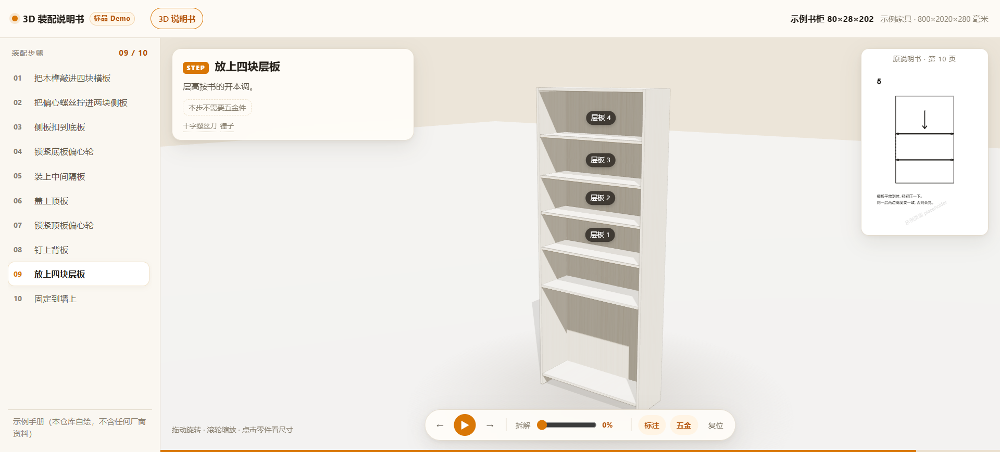

# 3D 说明书构建器

输入一份 JSON（零件 + 步骤 + 页图），输出一个可以直接打开的网页：3D 装配动画、逐步文案、五金数量、原说明书页对照、拆解滑杆、手机端适配。

引擎在 `engine/`（three.js 无依赖静态页），编译脚本是 `scripts/build.mjs`，校验脚本是 `scripts/check_sku.py`。

## 一条命令出成品

```bash
node scripts/build.mjs fixtures/demo-sku.json --out dist
# 产物: dist/demo-bookcase/index.html
```

打开 `dist/demo-bookcase/index.html` 即可（本地双击，不需要服务器、不联网）。



## 我需要你给什么

完整清单见 [references/输入清单.md](references/输入清单.md)。最短版本：

1. **整机尺寸**：宽 × 高 × 深，毫米。
2. **零件表**：每块板的名称、尺寸（毫米）、成品中心坐标（x, y, z）。
3. **步骤表**：每步做什么、这一步装哪几块板（用 id）、用什么五金多少。
4. **原页图**（可选）：每页一张图，加一句"第几步对应第几页"。

有这四样，我就能出**可交付级**的 3D。只给手册照片也行，我按 B 档人工读（1 到 2 天一款），读出来的数据会标"推断"。

字段、单位、枚举都在 [references/数据格式.md](references/数据格式.md)。填表模板在输入清单的最后一节。

## 多配置（一份手册画了两种尺寸）

顶层写 `configs: [{ id, label, size, parts, steps, stepPages }]`，构建时每个配置出一页，并在根目录生成选择页。校验脚本同样支持，逐个跑 G1 到 G5。字段见 [references/数据格式.md](references/数据格式.md)。

## 数据怎么写

```json
{
  "slug": "demo-bookcase",
  "name": "示例书柜 80×28×202",
  "size": { "w": 800, "h": 2020, "d": 280 },
  "parts": [
    { "id": "A", "name": "左侧板", "size": [18, 2020, 280], "pos": [-391, 1010, 0] }
  ],
  "steps": [
    { "title": "侧板扣到底板", "add": ["A", "B", "D"], "fix": [{ "kind": "dowel", "count": 8, "to": ["D"] }] }
  ],
  "stepPages": [{ "page": 6, "file": "pages/p06.png" }]
}
```

- `size` 是成品姿态的 `[宽,高,深]`，`pos` 是成品里的中心点，单位毫米。
- 相接的面必须贴合，算完核对一次。
- `stepPages[i]` 对应第 i 步；没有原页就写 null。

## 三条入口：从材料到成品

完整命令与读图要点见 [references/接单流程.md](references/接单流程.md)。

| 客户给什么 | 入口 | 命令 |
| --- | --- | --- |
| 手册照片 / PDF | 拆页 → 骨架 → 人工填 → 校验 → 构建 | `pdf2pages.py` → `new_sku.py` → 手改 JSON → `check_sku.py` → `build.mjs` |
| 两张表（零件 + 步骤） | 直接合成 | `csv2sku.py` → `check_sku.py` → `build.mjs` |
| 已经写好的 JSON | 直接校验构建 | `check_sku.py` → `build.mjs` |

```bash
# 手册路线
python scripts/pdf2pages.py 手册.pdf pages
python scripts/new_sku.py pages kehu-bookcase-80      # 出骨架
# 人读手册，填尺寸与步骤
python scripts/check_sku.py kehu-bookcase-80.json
node scripts/build.mjs kehu-bookcase-80.json --out dist

# 表格路线
python scripts/csv2sku.py 零件表.csv 步骤表.csv --slug kehu --name "客户书柜" --size 800x2020x280 --pages 6,7,7,8
python scripts/check_sku.py kehu.json
node scripts/build.mjs kehu.json --out dist
```

读手册的四步顺序：先零件清单页，再步骤图，再算坐标，最后核对接触面。常见坑（多视角数成多块板、层板被劈半、厘米当毫米、步骤按"应该"而不是按手册）写在接单流程里。

## 交付前必须先过校验

```bash
python scripts/check_sku.py my-sku.json
```

五条硬门槛，任何一条红都不许生成：

| 编号 | 检查 |
| --- | --- |
| G1 | 零件完整：名称、尺寸、位置合法，不超过整机 |
| G2 | 竖板数量与手册一致（家具通常 2 块） |
| G3 | 层板整块：宽度 ≥ 整机 80%，没有被劈成左右两半 |
| G4 | 引用闭合：步骤里的 id 都存在，零件都被用到 |
| G5 | 页映射与步数一致 |

校验通过后再跑 `build.mjs`。改过脚本先用 `fixtures/good.json`（应全过）和 `fixtures/bad.json`（应报 G2 到 G5）回归一次。

## 产物里有什么

```
dist/<slug>/
├── index.html          双击打开
├── data/sku.js         这份数据（改文案改这里，刷新即生效）
├── manual-pages/       原页图
├── vendor/             three.js（离线可用）
└── 打开说明.txt
```

- 快捷键：`←` `→` 切换步骤，空格自动播放，拖动旋转，滑杆拆解。
- 换一款产品：另写一份 JSON，再跑一次 `build.mjs`，不改代码。

## 近似与边界（要跟客户说清）

- 零件是**按尺寸生成的几何体**（盒/柱），不是真实外观；要真实外形得给 glTF/STEP。
- 五金摆位是**示意**：类型、数量、步骤对得上，孔距不保证。
- 拆解方向、镜头距离是自动算的，个别产品会显得挤，可在 JSON 里加 `"camera": {"pos": [...], "target": [...]}` 覆盖。
- 尺寸来自你给的数据；我按手册推算时会标"推断"，不做开料图纸。
- 平板结构（柜、桌、床架）最稳；带液压、多轨抽屉、玻璃门的，五金会简化。

## 两条分支

- **只有手册、没有数据**：我人工读成 JSON（1 到 2 天），再走上面的流程。
- **有 CAD/STEP**：先转 glTF，再给引擎加加载器（约 2 天）；步骤仍需人编。

## 样例

- `fixtures/demo-sku.json`：10 步书柜，含 6 页示例原页图，跑一遍能出完整成品。
- `fixtures/good.json` / `fixtures/bad.json`：校验器的正反样例。
