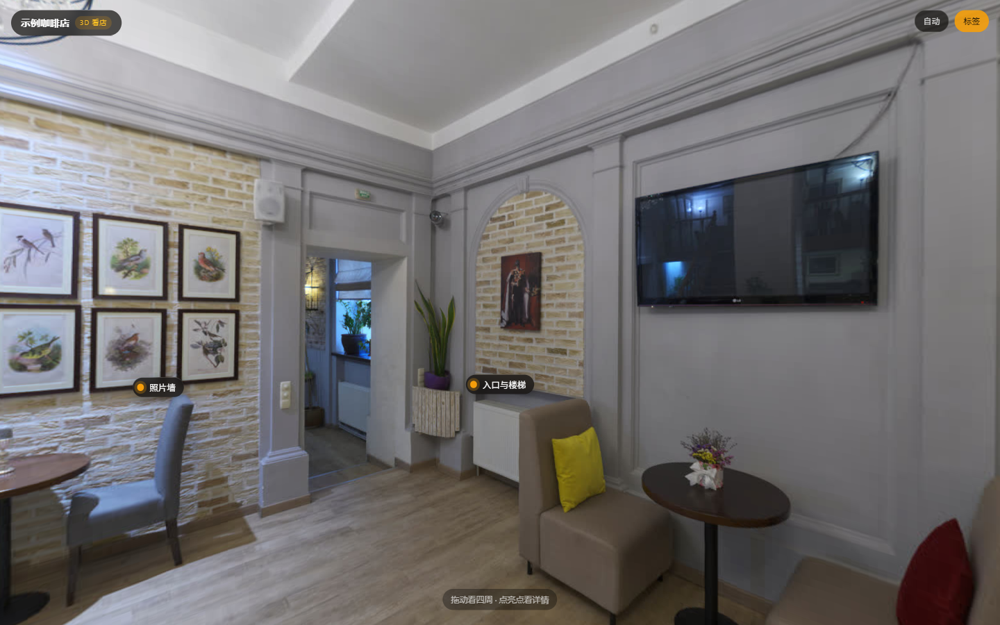

# 3D 看店 / 看厂（全景 + 热点）

一张手机拍的全景图，加上几个热点，就能变成一个能拖动、能点开详情的 3D 页面。成本最低的"店里 3D"，不需要建模。

引擎在 `engine/`（three.js 球面贴图，离线可用），编译脚本 `scripts/build.mjs`。



## 一条命令出成品

```bash
node scripts/build.mjs fixtures/cafe/space.json --out dist
# 产物: dist/cafe/index.html
```

全景图编译时会**内联成 data URL**：双击 `index.html` 就能看，不需要起服务器（file:// 下 WebGL 读本地图片会被 CORS 拦，内联绕开）。

## 输入

一份 `space.json` + 一张全景图（同一目录）：

```json
{
  "slug": "cafe",
  "name": "示例咖啡店",
  "pano": "pano.jpg",
  "yawOffset": 0,
  "hotspots": [
    { "label": "吧台", "yaw": -60, "pitch": -5, "desc": "点单与出品区。", "price": "人均 ¥38" }
  ]
}
```

- 全景图：**2:1 的等距柱状图**（手机全景模式拍出来就是这个），4096×2048 够用，压到 1MB 以内加载快。
- `yaw`：水平角度，0 是页面默认朝向，正数向右转，单位度。
- `pitch`：上下角度，-85 到 85，负数往下看。
- `desc` / `price` 可选，点了才显示。

字段细节与标注方法见 [references/拍摄与标注.md](references/拍摄与标注.md)。

## 交付产物

```
dist/<slug>/
├── index.html      双击打开
├── data/space.js   热点数据（改标签、改角度改这里）
├── pano.jpg        原始全景（内联版在 space.js 里）
└── 打开说明.txt
```

嵌入网页/小程序：把整个目录挂到静态托管，用 `iframe` 指向 `index.html`，或在小程序里用 `web-view` 加载。

## 边界（跟客户说清）

- 这是**全景环视 + 热点**，不是真 3D：不能走动，不能绕到物体背后。
- 要"走动看"就得拍多个机位，做机位切换（下一版加）。
- 要"绕着商品转"用转台图序列（另一条线），不是这个。
- 拍摄质量决定成败：光比太大、手持抖、站的位置不对，出来的页面会晕。

## 拍摄要求（最短版）

1. 站在店里**最想让人看到的位置**，手机举到约 1.5 米高。
2. 用系统相机自带的**全景模式**，水平转一圈，保持手机竖直、别上下晃。
3. 光线均匀时拍；不要逆光对着门/窗。
4. 拍完在手机上看一圈：接缝明显、地面断裂就重拍。
5. 一个店可以拍 2 到 3 个机位（门口、吧台、座位区），后面做机位切换。

## 行业用法

- 餐饮：门口机位 + 菜单/招牌热点，点开看菜品图与价格。
- 零售：货架热点，点开看单品。
- 工厂/展厅：车间机位，点开看设备与参数。
- 民宿/样板间：房间机位，点开看设施。
